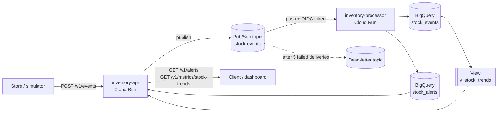
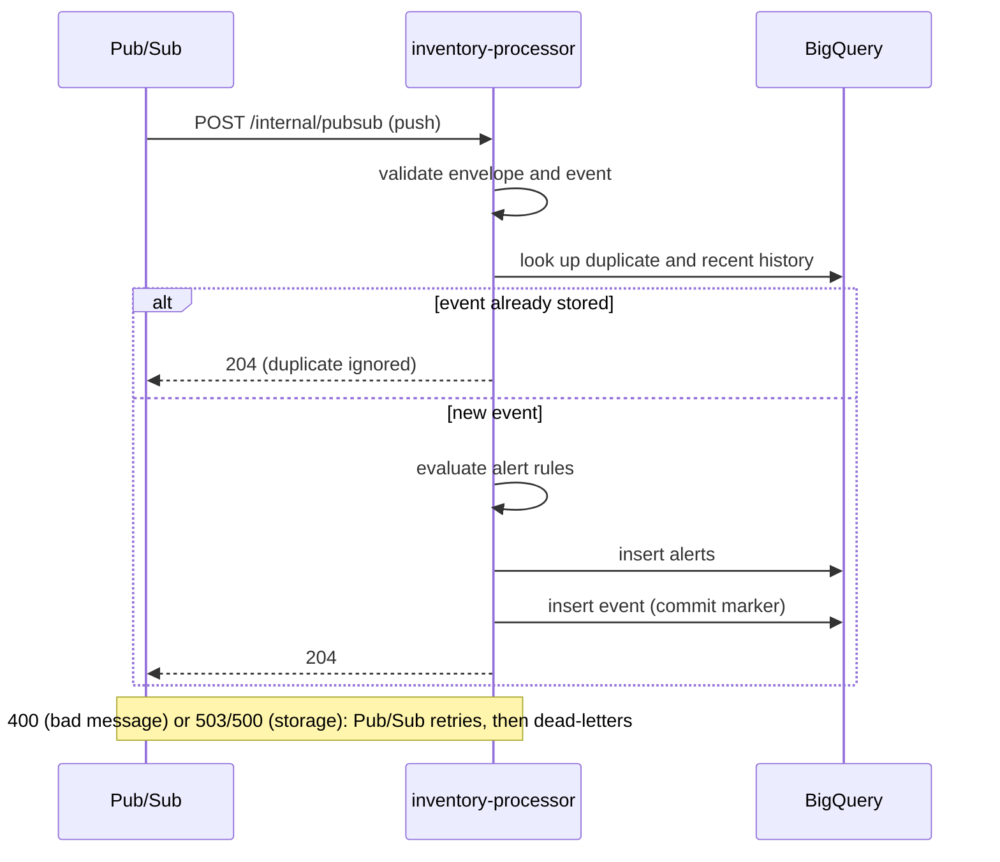
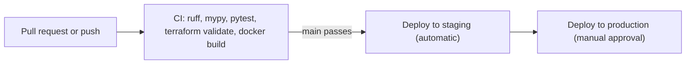

# Real-Time Inventory Event Platform

[English](README.md) | **Español**

Plataforma orientada a eventos que recibe cambios de stock de tiendas, los procesa de forma asíncrona y los convierte en alertas y tendencias. Es un proyecto de portfolio pensado para mostrar backend de nivel producción: diseño de APIs, procesamiento asíncrono, absorción de picos de tráfico, idempotencia, observabilidad y despliegue cloud-native en Google Cloud.

> **Estado: las cinco fases están escritas, probadas y listas para desplegar; la infraestructura todavía no se ha aplicado a un proyecto real de Google Cloud.** La API recibe y publica eventos y sirve alertas y tendencias de stock por hora; el procesador consume los eventos de Pub/Sub, los deduplica por `event_id`, aplica las reglas de alerta y escribe eventos y alertas en BigQuery. Terraform y el pipeline de CI/CD están listos.

## Estado de verificación

| Verificado | Pendiente |
|---|---|
| 546 tests automáticos, `ruff`, `mypy` (se ejecutan en el CI en cada push) | Primer despliegue en un proyecto real de Google Cloud |
| `terraform fmt` y `terraform validate` | Ejecutar los adaptadores de BigQuery y el SQL contra tablas reales |
| Las imágenes Docker se construyen en el CI | Entrega push de Pub/Sub y flujo de dead-letter de extremo a extremo |
| | Prueba de carga con el simulador contra la API desplegada |

El paso que falta es un despliegue en staging siguiendo [`docs/runbook.md`](docs/runbook.md#deploy). Hasta entonces, las integraciones con la nube están cubiertas por tests con dobles, no por una ejecución real.

## Contenido

[Arquitectura](#arquitectura) · [Hoja de ruta](#hoja-de-ruta) · [Puesta en marcha](#puesta-en-marcha) · [API](#api) · [Despliegue](#despliegue) · [Subir a GitHub](#subir-a-github) · [Seguridad](#seguridad) · [Configuración](#configuración) · [Contrato del evento](#contrato-del-evento) · [Decisiones técnicas](#decisiones-técnicas)

## Arquitectura



La API responde `202 Accepted` en cuanto el evento está publicado; nunca ejecuta lógica de negocio. Todo lo pesado ocurre en el procesador, así que una ráfaga de tráfico se acumula en Pub/Sub en lugar de saturar nada.

Cómo trata el procesador un mensaje:



| Servicio | Responsabilidad |
|---|---|
| `api/` | Ingesta y consultas REST: validación, autenticación con API key, publicación, endpoints de alertas y tendencias |
| `processor/` | Consumidor push de Pub/Sub: deduplicación, escritura en BigQuery, reglas de alerta |
| `common/` | Código compartido: contrato del evento, logging estructurado, manejo de errores, health |
| `infra/` | Terraform: Cloud Run, Pub/Sub, BigQuery, IAM, Secret Manager, monitorización |

Cada servicio mantiene una arquitectura hexagonal ligera: los puntos de entrada (`routes`, `consumers`) llaman a `services`, que usan lógica de `domain` y llegan a Google Cloud solo a través de pequeños adaptadores (`publishers`, `repositories`) que se inyectan, de modo que los tests nunca necesitan Google Cloud.

Reglas de alerta: `OUT_OF_STOCK` (cantidad 0), `LOW_STOCK` (cantidad de 5 o menos) y `RAPID_STOCK_DROP` (caída de más del 50 % en 15 minutos).

## Hoja de ruta

| Fase | Alcance | Estado |
|---|---|---|
| 1 | Fundaciones: estructura, configuración, logging, errores, health, validación, Docker | Hecha |
| 2 | Ingesta: `POST /v1/events`, `:batch`, API keys, publicación en Pub/Sub, idempotencia, rate limiting, simulador | Hecha |
| 3 | Procesamiento: endpoint push, escritura en BigQuery, deduplicación, reintentos, errores aptos para DLQ, reglas de alerta | Hecha (el adaptador de BigQuery aún no se ha probado con un proyecto real) |
| 4 | Analítica: `GET /v1/alerts`, `GET /v1/metrics/stock-trends`, vista `v_stock_trends` | Hecha (el SQL aún no se ha ejecutado en un proyecto real) |
| 5 | Infraestructura: Terraform, CI/CD, runbook | Hecha (nunca aplicada a un proyecto real) |

Sin implementar: las reglas de pico de ventas y de tienda sin datos, un enfriamiento de alertas y un almacén compartido para el rate limiting.

## Puesta en marcha

Requisitos: Python 3.12 y `make` (Linux, macOS, WSL o Git Bash). Si está instalado, se usa [`uv`](https://docs.astral.sh/uv/).

```bash
cp .env.example .env
make install          # crea .venv e instala el proyecto con las herramientas de desarrollo
make check            # ruff + mypy + pytest
make run-api          # http://localhost:8080/v1/health
make run-processor    # http://localhost:8081/v1/health
```

Enviar tráfico simulado (con `PUBSUB_TOPIC_ID` vacío la API solo registra los eventos en el log, así que no hace falta Google Cloud; el procesador necesita Pub/Sub para recibir algo, por eso en local se prueba con sus tests o enviándole un sobre push, ver [`docs/runbook.md`](docs/runbook.md)):

```bash
python -m simulator.store_simulator --api-key local-dev-key-change-me --events 200
python -m simulator.store_simulator --api-key local-dev-key-change-me --events 5000 --batch-size 100 --rate 0
```

En Windows PowerShell, ejecuta directamente los comandos de fondo: crea un entorno virtual con `py -3.12 -m venv`, `pip install -e ".[dev]"`, y luego `ruff check .; ruff format --check .; mypy; pytest` y `python -m flask --app "api.app:create_app" run`.

Si el repositorio está en una carpeta de OneDrive o Dropbox, mantén el entorno virtual fuera de ella: `make install VENV=$HOME/.venvs/inventory` y pasa el mismo `VENV` a los demás objetivos.

Las imágenes Docker se construyen desde la raíz del repositorio:

```bash
make docker-api
make docker-processor
docker run --rm -p 8080:8080 inventory-api:local
```

## API

| Endpoint | Para qué sirve |
|---|---|
| `GET /v1/health` | Comprobación de vida (sin clave) |
| `POST /v1/events` | Ingesta de un evento; `202` cuando Pub/Sub lo ha confirmado |
| `POST /v1/events:batch` | Ingesta de hasta 100 eventos; los válidos se publican aunque otros se rechacen (`207`) |
| `GET /v1/alerts` | Alertas, de más reciente a más antigua; filtros por tienda, SKU, tipo, severidad, estado y fecha; paginado |
| `GET /v1/metrics/stock-trends` | Vendido, repuesto, stock medio, eventos y variación por hora, tienda y SKU |
| `POST /internal/pubsub` | (procesador) Endpoint push de Pub/Sub; no es para clientes, protegido por IAM de Cloud Run |

Las peticiones llevan la cabecera `X-API-Key`. Los detalles, códigos de estado y ejemplos están en [`docs/api.md`](docs/api.md) (en inglés).

## Despliegue

Terraform (`infra/`) crea Cloud Run, Pub/Sub con cola de mensajes fallidos (DLQ), BigQuery, Secret Manager, Artifact Registry, IAM, Workload Identity Federation para GitHub Actions y alertas de Cloud Monitoring. GitHub Actions despliega: staging automáticamente desde `main` y producción con aprobación manual.



El procedimiento paso a paso (bucket de estado, secreto, primer apply, variables de GitHub, rollback, reproceso de la DLQ) está en [`docs/runbook.md`](docs/runbook.md#deploy).

```bash
cd infra
terraform fmt -recursive && terraform init -backend=false && terraform validate   # comprobar sin acceso a la nube
terraform init -backend-config="bucket=<bucket-de-estado>" -backend-config="prefix=staging"
terraform plan -var-file=environments/staging.tfvars
```

## Subir a GitHub

1. En GitHub, crea un repositorio nuevo **vacío** (sin README, licencia ni `.gitignore`: el proyecto ya los tiene).
2. Revisa qué se va a subir. No debe aparecer ningún archivo `.env`, clave ni `*.tfvars`:

   ```powershell
   git status
   git ls-files | Select-String -Pattern "\.env$|\.tfvars$|\.pem$|\.key$"
   ```

3. Conecta el repositorio y súbelo (sustituye `<usuario>` y `<repo>`):

   ```powershell
   git remote add origin https://github.com/<usuario>/<repo>.git
   git branch -M main
   git push -u origin main
   ```

   La primera vez GitHub te pedirá iniciar sesión (ventana del navegador con Git Credential Manager, o un token de acceso personal como contraseña).

   Con la [CLI de GitHub](https://cli.github.com/) basta un comando: `gh auth login` y luego `gh repo create <repo> --private --source . --remote origin --push`.

4. Abre la pestaña **Actions** y comprueba que el workflow **CI** pasa. El workflow `Deploy` no hace nada hasta que existan las variables de GCP (ver el runbook), así que es normal que se omita o falle al principio.
5. Opcional: haz público el repositorio desde **Settings, General, Danger Zone** cuando hayas revisado el historial.

Cambios posteriores: `git add -A; git commit -m "mensaje"; git push`.

## Seguridad

La autenticación, los límites de entrada, el SQL parametrizado, los topes de coste de las consultas y las carencias conocidas están en [`docs/security.md`](docs/security.md).

## Configuración

Los ajustes vienen de variables de entorno (ver [`.env.example`](.env.example)). Nada de proyecto, región, URL o credenciales está escrito en el código. Fuera de `ENVIRONMENT=local`, los servicios no arrancan sin `GCP_PROJECT_ID` (y, en la API, sin `API_KEYS`, con claves de al menos 24 caracteres).

## Contrato del evento

```json
{
  "event_id": "evt_01J5Z8K9Q2M7",
  "store_id": "store_014",
  "sku": "SKU-88231",
  "event_type": "STOCK_UPDATED",
  "quantity": 3,
  "previous_quantity": 18,
  "unit": "units",
  "occurred_at": "2026-11-16T19:40:12Z",
  "source": "pos-system",
  "metadata": { "region": "asturias", "channel": "physical_store" }
}
```

La validación es estricta: los enteros deben ser enteros reales, `occurred_at` debe ser una fecha ISO 8601 con zona horaria, `metadata` está limitado a 4096 bytes y los campos desconocidos se rechazan. Un payload inválido recibe `400` con los problemas listados por campo:

```json
{
  "status": "rejected",
  "errors": [
    { "field": "quantity", "message": "must be an integer greater than or equal to 0" }
  ]
}
```

## Decisiones técnicas

- **Dos servicios, un repositorio.** La API se mantiene rápida y sin estado; el procesador escala con las entregas de Pub/Sub. El código compartido vive en `common/` para que el contrato no se desincronice.
- **Logs JSON estructurados** con los nombres de campo de Cloud Logging, y `trace_id`, `event_id`, `store_id` y `sku` en cada línea mediante una variable de contexto.
- **Los errores siempre son JSON.** Las excepciones inesperadas se registran con su traza, pero nunca se devuelven al cliente.
- **Las fechas sin zona horaria se rechazan** en lugar de adivinarlas, porque una suposición errónea corrompe en silencio las agregaciones por hora.
- **`202` significa que Pub/Sub tiene el evento.** La API espera la confirmación del broker, así que el cliente puede reintentar sin riesgo; nunca da por bueno un evento que no se publicó.
- **Idempotencia y rate limiting por proceso** (sin Redis): ambos son optimizaciones delante de Pub/Sub. El procesador deduplica por `event_id` en BigQuery, así que no pueden causar pérdida de datos ni duplicados aguas abajo.
- **La fila del evento es la marca de confirmación.** El procesador escribe primero las alertas y al final el evento, de modo que un fallo en cualquier punto se repara con la reentrega de Pub/Sub. Las alertas tienen ids deterministas, así que un reintento nunca crea una segunda alerta.
- **Mensajes inválidos dan `400`, problemas de almacenamiento dan `503`.** La política de dead-letter de Pub/Sub aparta el mensaje tras N entregas fallidas; nada se descarta en silencio.
- **`insert_rows_json` en lugar de la Storage Write API**, con `insertId`, reintentos y un compromiso documentado (ver `processor/repositories/bigquery.py`). El adaptador está detrás de un puerto, así que se puede sustituir después por uno de Storage Write API.
- **Límites de coste y seguridad en las lecturas.** Toda consulta tiene un límite temporal, los valores del cliente son solo parámetros y BigQuery rechaza consultas por encima de un tope de bytes facturados.

Más detalle en [`docs/architecture.md`](docs/architecture.md), [`docs/api.md`](docs/api.md) y [`docs/security.md`](docs/security.md) (los documentos técnicos están en inglés).
