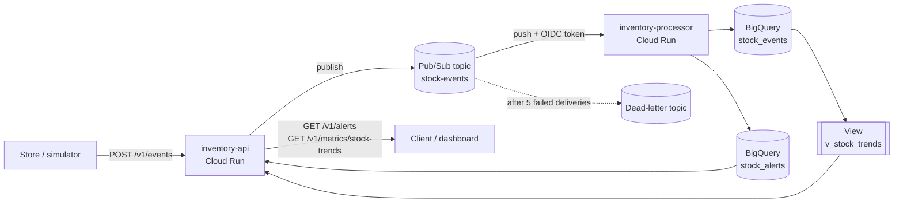
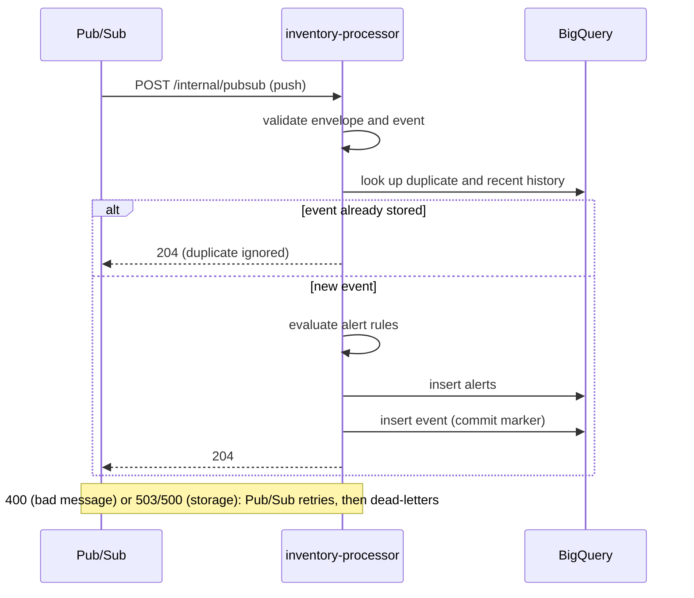
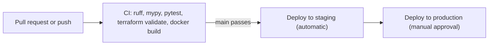

# Real-Time Inventory Event Platform

**English** | [Español](README.es.md)

[](https://github.com/fedex85/event-processing-platform/actions/workflows/ci.yml)  [](LICENSE)

An event-driven platform that ingests stock changes from stores, processes them asynchronously and turns them into alerts and trends. It is a portfolio project built to show production-minded backend work: API design, asynchronous processing, spike absorption, idempotency, observability and cloud-native deployment on Google Cloud.

> **Status: all five phases are written, tested and ready to deploy; the infrastructure has not been applied to a real Google Cloud project yet.** The API ingests and publishes events and serves alerts and hourly stock trends; the processor consumes events from Pub/Sub, deduplicates them by `event_id`, applies the alert rules and writes events and alerts to BigQuery. Terraform and the CI/CD pipeline are in place.

## Verification status

| Verified | Pending |
|---|---|
| 546 automated tests, `ruff`, `mypy` (run in CI on every push) | First deployment to a real Google Cloud project |
| `terraform fmt` and `terraform validate` | Running the BigQuery adapters and SQL against real tables |
| Docker images build in CI | Pub/Sub push delivery and the dead-letter flow end to end |
| | Load test with the simulator against the deployed API |

The remaining step is a staging deployment following [`docs/runbook.md`](docs/runbook.md#deploy). Until then, the cloud integrations are covered by tests with fakes, not by a live run.

## Contents

[Architecture](#architecture) · [Roadmap](#roadmap) · [Getting started](#getting-started) · [API](#api) · [Deploy](#deploy) · [Publish to GitHub](#publish-to-github) · [Security](#security) · [Configuration](#configuration) · [Event contract](#event-contract) · [Technical decisions](#technical-decisions)

## Architecture



The API answers `202 Accepted` once the event is published; it never runs business logic. Everything heavier happens in the processor, so a burst of traffic queues up in Pub/Sub instead of overloading anything.

How the processor handles one message:



| Service | Responsibility |
|---|---|
| `api/` | REST ingestion and queries: validation, API-key auth, publishing, alerts and trends endpoints |
| `processor/` | Pub/Sub push consumer: deduplication, BigQuery writes, alert rules |
| `common/` | Code both services share: event contract, structured logging, error handling, health |
| `infra/` | Terraform: Cloud Run, Pub/Sub, BigQuery, IAM, Secret Manager, monitoring |

Each service keeps a light hexagonal layout: entry points (`routes`, `consumers`) call `services`, which use `domain` logic and reach Google Cloud only through small adapters (`publishers`, `repositories`) that are injected, so tests never need Google Cloud.

Alert rules: `OUT_OF_STOCK` (quantity 0), `LOW_STOCK` (quantity of 5 or fewer) and `RAPID_STOCK_DROP` (more than a 50% fall inside 15 minutes).

## Roadmap

| Phase | Scope | State |
|---|---|---|
| 1 | Foundations: structure, config, logging, errors, health, validation, Docker | Done |
| 2 | Ingestion: `POST /v1/events`, `:batch`, API keys, Pub/Sub publishing, idempotency, rate limiting, simulator | Done |
| 3 | Processing: push endpoint, BigQuery writes, deduplication, retries, DLQ-ready errors, alert rules | Done (BigQuery adapter not yet run against a real project) |
| 4 | Analytics: `GET /v1/alerts`, `GET /v1/metrics/stock-trends`, `v_stock_trends` view | Done (SQL not yet run against a real project) |
| 5 | Infrastructure: Terraform, CI/CD, runbook | Done (never applied to a real project) |

Not implemented: the sales-spike and store-without-data rules, an alert cooldown and a shared rate-limit store.

## Getting started

Requirements: Python 3.12 and `make` (Linux, macOS, WSL or Git Bash). [`uv`](https://docs.astral.sh/uv/) is used when installed.

```bash
cp .env.example .env
make install          # creates .venv and installs the project with dev tools
make check            # ruff + mypy + pytest
make run-api          # http://localhost:8080/v1/health
make run-processor    # http://localhost:8081/v1/health
```

Send simulated traffic (with `PUBSUB_TOPIC_ID` empty the API only logs the events, so no Google Cloud is needed; the processor needs Pub/Sub to receive anything, so locally it is exercised through its tests or by posting a push envelope, see [`docs/runbook.md`](docs/runbook.md)):

```bash
python -m simulator.store_simulator --api-key local-dev-key-change-me --events 200
python -m simulator.store_simulator --api-key local-dev-key-change-me --events 5000 --batch-size 100 --rate 0
```

On Windows PowerShell, run the underlying commands directly: create a virtualenv with `py -3.12 -m venv`, `pip install -e ".[dev]"`, then `ruff check .; ruff format --check .; mypy; pytest` and `python -m flask --app "api.app:create_app" run`.

If the repository lives in a OneDrive or Dropbox folder, keep the virtualenv outside it: `make install VENV=$HOME/.venvs/inventory` and pass the same `VENV` to the other targets.

Docker images are built from the repository root:

```bash
make docker-api
make docker-processor
docker run --rm -p 8080:8080 inventory-api:local
```

## API

| Endpoint | Purpose |
|---|---|
| `GET /v1/health` | Liveness check (no key needed) |
| `POST /v1/events` | Ingest one event; `202` once Pub/Sub has confirmed it |
| `POST /v1/events:batch` | Ingest up to 100 events; valid ones are published even if others are rejected (`207`) |
| `GET /v1/alerts` | Alerts, newest first; filters by store, SKU, type, severity, status and time; paginated |
| `GET /v1/metrics/stock-trends` | Hourly sold, restocked, average stock, events and variation per store and SKU |
| `POST /internal/pubsub` | (processor) Pub/Sub push endpoint; not for clients, protected by Cloud Run IAM |

Requests carry an `X-API-Key` header. Details, status codes and examples are in [`docs/api.md`](docs/api.md).

## Deploy

Terraform (`infra/`) creates Cloud Run, Pub/Sub with a dead-letter queue, BigQuery, Secret Manager, Artifact Registry, IAM, Workload Identity Federation for GitHub Actions and Cloud Monitoring alerts. GitHub Actions deploys: staging automatically from `main`, production on manual approval.



The step-by-step procedure (state bucket, secret, first apply, GitHub variables, rollback, dead-letter replay) is in [`docs/runbook.md`](docs/runbook.md#deploy).

```bash
cd infra
terraform fmt -recursive && terraform init -backend=false && terraform validate   # check without cloud access
terraform init -backend-config="bucket=<state-bucket>" -backend-config="prefix=staging"
terraform plan -var-file=environments/staging.tfvars
```

## Publish to GitHub

1. On GitHub, create a new **empty** repository (no README, license or `.gitignore`: the project already has them).
2. Check what will be uploaded. No `.env`, key or `*.tfvars` file should appear in the list:

   ```powershell
   git status
   git ls-files | Select-String -Pattern "\.env$|\.tfvars$|\.pem$|\.key$"
   ```

3. Connect the repository and push (replace `<user>` and `<repo>`):

   ```powershell
   git remote add origin https://github.com/<user>/<repo>.git
   git branch -M main
   git push -u origin main
   ```

   GitHub asks you to sign in the first time (browser window from Git Credential Manager, or a personal access token as the password).

   With the [GitHub CLI](https://cli.github.com/) it is a single command: `gh auth login`, then `gh repo create <repo> --private --source . --remote origin --push`.

4. Open the **Actions** tab and check that the **CI** workflow passes. The `Deploy` workflow does nothing until the GCP variables exist (see the runbook), so it is fine if it is skipped or fails at first.
5. Optional: make the repository public from **Settings, General, Danger Zone** once you have reviewed the history.
6. Configure branch protection, security scanning and the deployment environments with the checklist in [`docs/runbook.md`](docs/runbook.md#github-repository-settings).

Later changes: `git add -A; git commit -m "message"; git push`.

## Security

Authentication, input limits, parameterized SQL, query cost caps and the known gaps are listed in [`docs/security.md`](docs/security.md).

## Configuration

Settings come from environment variables (see [`.env.example`](.env.example)). Nothing about a project, region, URL or credential is hardcoded. Outside `ENVIRONMENT=local` the services refuse to start without `GCP_PROJECT_ID` (and, for the API, `API_KEYS`, with keys of at least 24 characters).

## Event contract

```json
{
  "event_id": "evt_01J5Z8K9Q2M7",
  "store_id": "store_014",
  "sku": "SKU-88231",
  "event_type": "STOCK_UPDATED",
  "quantity": 3,
  "previous_quantity": 18,
  "unit": "units",
  "occurred_at": "2026-11-16T19:40:12Z",
  "source": "pos-system",
  "metadata": { "region": "asturias", "channel": "physical_store" }
}
```

Validation is strict: integers must be real integers, `occurred_at` must be an ISO 8601 timestamp that includes a timezone, `metadata` is limited to 4096 bytes and unknown fields are rejected. Invalid payloads get `400` with the problems listed per field:

```json
{
  "status": "rejected",
  "errors": [
    { "field": "quantity", "message": "must be an integer greater than or equal to 0" }
  ]
}
```

## Technical decisions

- **Two services, one repository.** The API stays fast and stateless; the processor scales on Pub/Sub delivery. Shared code lives in `common/` so the contract cannot drift between them.
- **Structured JSON logs** using Cloud Logging's field names, with `trace_id`, `event_id`, `store_id` and `sku` attached to every line through a context variable.
- **Errors are always JSON.** Unexpected exceptions are logged with a stack trace but never returned to the client.
- **Timestamps without a timezone are rejected** rather than guessed, because a wrong guess silently corrupts hourly aggregations.
- **`202` means Pub/Sub has the event.** The API waits for the broker's confirmation, so a client can retry safely; it never reports success for an event that was not published.
- **Events outside BigQuery's streaming window are refused at the door.** It only streams into partitions 31 days back and 16 ahead, so the API answers `400` for an `occurred_at` outside 30 days back and 15 ahead instead of accepting an event that could never be stored.
- **Per-process idempotency and rate limiting** (no Redis): both are optimizations in front of Pub/Sub. The processor deduplicates by `event_id` in BigQuery, so they cannot cause data loss or duplicates downstream.
- **The event row is the commit marker.** The processor writes alerts first and the event last, so a failure at any point is repaired by Pub/Sub's redelivery. Alerts have deterministic ids, so a retry never creates a second alert.
- **Poison messages get `400`, storage trouble gets `503`.** Pub/Sub's dead-letter policy moves a message aside after N failed deliveries; nothing is silently dropped.
- **`insert_rows_json` instead of the Storage Write API**, with `insertId`, retries and a documented trade-off (see `processor/repositories/bigquery.py`). The adapter sits behind a port, so a Storage Write API adapter can replace it later.
- **Cost and safety limits on reads.** Every query has a time bound, client values are only query parameters and BigQuery refuses queries above a bytes-billed cap.

More detail in [`docs/architecture.md`](docs/architecture.md), [`docs/api.md`](docs/api.md) and [`docs/security.md`](docs/security.md) (the technical documents are in English).

## License

[MIT](LICENSE). Contributions: see [`CONTRIBUTING.md`](CONTRIBUTING.md); security reports: [`SECURITY.md`](SECURITY.md).
